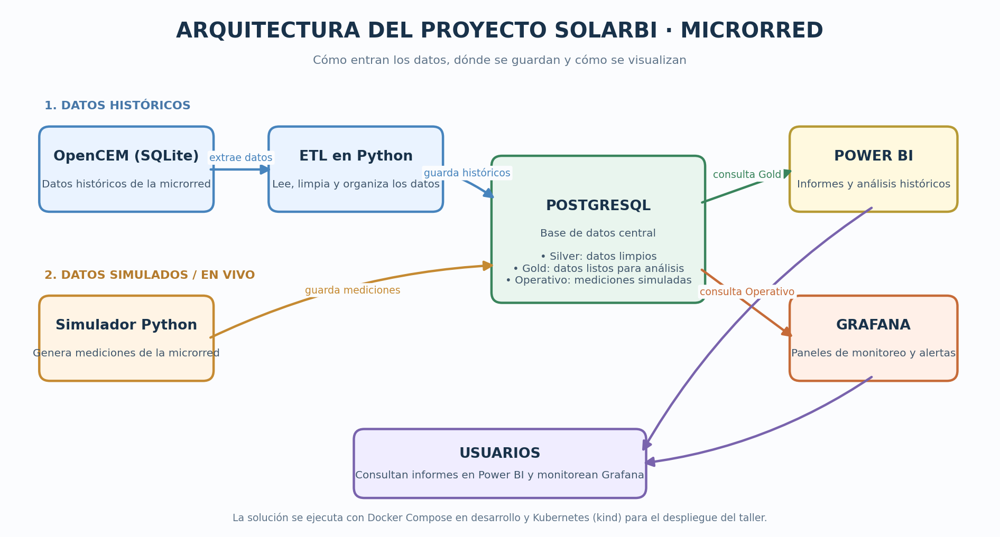

# Taller 6 – BI contenerizado para una microrred híbrida

Solución de Inteligencia de Negocios de extremo a extremo sobre la telemetría de una microrred híbrida (solar + batería + red): ETL reproducible con validación de calidad, modelo dimensional en PostgreSQL, tablero analítico en Power BI y tablero operativo en Grafana con alertas, desplegado sobre un clúster local de Kubernetes.

**Enfoque de profundización (Línea 3):** SolarBI: estimación del ahorro económico de la generación solar con la tarifa colombiana.

**Curso:** Inteligencia de Negocios 2026-II · Institución Universitaria Pascual Bravo · Docente: Ramiro Grisales Montoya

## Integrantes
| Integrante | Responsabilidad principal |
|---|---|
| Sammy Arteaga Velasquez  | Repositorio, Power BI, ética y seguridad, ensamblado del informe |
| Shirley Johanna Grajales Arango | Datos, diagnóstico de calidad, ETL |
| Yuritza Mendoza Mosquera | Catálogo de indicadores, modelo dimensional, PostgreSQL |
| Laura Mejia Delgado | Docker, Kubernetes, Grafana, simulador |

## Datos y licencia
Datos: OpenCEM v1.0.0 (Zenodo, DOI 10.5281/zenodo.21436223), licencia CC BY 4.0.
Los datos **no** están en este repositorio. Descarga y verificación: ver [`data/README.md`](data/README.md).

**Cita:** Bartels, T. S., Wu, R., Lu, X., Chen, Y., Lu, Y., Xia, F., Yang, H., Chen, Y., & Li, T. (2026). *OpenCEM: Multimodal photovoltaic and battery microgrid dataset with context records and sky imagery* (Version 1.0.0) [Dataset]. Zenodo. https://doi.org/10.5281/zenodo.21436223

## Estructura del repositorio
```
├── etl/          Código y Dockerfile del ETL (Bronze → Silver → Gold)
├── simulador/    Simulador de datos nuevos y su Dockerfile
├── sql/          DDL, consultas analíticas y consulta con JSON
├── k8s/          Manifiestos de Kubernetes
├── grafana/      Dashboard exportado y provisioning
├── powerbi/      Proyecto Power BI en formato .pbip
├── docs/         Diagramas, diccionario de datos, capturas
└── data/         Vacía; ver data/README.md
```

## Arquitectura

<p align="center">
  
</p>

*Figura 1. Arquitectura de la solución: datos históricos (OpenCEM → ETL → PostgreSQL → Power BI) y datos simulados en vivo (simulador → PostgreSQL → Grafana).*

**Flujo de datos.** El ETL lee el `.sqlite` de OpenCEM (capa **Bronze**, sin modificar), valida y agrega a intervalos de 15 minutos en **Silver** y carga el modelo en estrella de **Gold** (`dim_fecha`, `dim_hora`, `dim_inversor`, `dim_tarifa`, `fact_energia_intervalo`, `fact_ahorro_diario`). El esquema `bi` expone vistas para consumo externo y `operativo` guarda la telemetría simulada.

| Componente | Tecnología | Función |
|---|---|---|
| Clúster | kind (un nodo) | Kubernetes local; se crea y se destruye con un comando |
| Base de datos | PostgreSQL 16.4 (`StatefulSet` + `PVC` de 5 Gi) | Esquemas `silver`, `gold`, `bi` y `operativo`; se inicializa con los SQL de `sql/` |
| ETL | Python 3.12 (`Job`, imagen `microrred/etl`) | Bronze → Silver → Gold, idempotente, con validación de calidad |
| Simulador | Python 3.12 (`CronJob`, imagen `microrred/simulador`) | Genera datos nuevos cada minuto con escenarios de falla (batería, inversor, telemetría) |
| Tablero operativo | Grafana 11.3.0 | Dashboards y alertas cargados por *provisioning* desde `ConfigMap`s |
| Tablero analítico | Power BI Desktop (`.pbip`) | Modelo en estrella, medidas DAX y simulador de tarifas (What-If) |
| Credenciales | `Secret bi-credentials` | Creado por los scripts desde `k8s/.env` (fuera de git) |

Detalle de cada objeto de Kubernetes y su justificación: [`docs/k8s-grafana.md`](docs/k8s-grafana.md).

## Requisitos del equipo anfitrión
- Sistema: Windows 10/11 (64 bits), Linux o macOS, con unos 8 GB de RAM libres y virtualización activada.
- **Docker Desktop** (o Docker Engine en Linux) con el motor corriendo.
- **kind** y **kubectl**. Probado con Docker Desktop 4.100, kind v0.33 y kubectl v1.37.
- **PowerShell** (Windows) o **Bash** (Linux/macOS) para los scripts de `scripts/`.
- **Git**, para clonar el repositorio.
- **Power BI Desktop** (solo Windows) para abrir `powerbi/SolarBI_Microrred.pbip`.
- Opcional: **DBeaver** u otro cliente SQL para consultar PostgreSQL.
- Puertos libres en el anfitrión: **3000** (Grafana) y **5432** (PostgreSQL). Si algún servicio local ya los usa, ver la nota al final de la siguiente sección.

## Cómo reproducir desde cero
1. Clonar el repositorio y entrar a la carpeta del proyecto.
2. *(Datos reales)* Descargar el `.sqlite` de OpenCEM y guardarlo en `data/` (ver [`data/README.md`](data/README.md)). Ajustar `SQLITE_PATH` en `k8s/configmap.yaml` al nombre real del archivo.
3. **Levantar todo** (clúster, imágenes, PostgreSQL, Grafana y simulador):

   ```powershell
   # Windows (PowerShell)
   Set-ExecutionPolicy -Scope Process Bypass
   .\scripts\up.ps1
   ```
   ```bash
   # Linux / macOS
   ./scripts/up.sh
   ```
   La primera vez tarda unos minutos y crea `k8s/.env` con claves aleatorias (no se sube a git).
4. **Cargar los datos:**

   ```powershell
   .\scripts\etl.ps1               # Bronze → Silver → Gold con los datos reales (./scripts/etl.sh en Linux/macOS)
   .\scripts\demo-sintetico.ps1    # solo si aún no se tiene el .sqlite: datos sintéticos de junio de 2026
   ```
5. **Usar:**
   - Grafana: http://localhost:3000, usuario `admin` y la clave `GF_SECURITY_ADMIN_PASSWORD` de `k8s/.env`. Dashboards *Operativo en vivo* e *Histórico (Gold)*, y reglas en *Alerting*.
   - PostgreSQL: `localhost:5432`, base `microrred_bi`, usuario de solo lectura `bi_lectura` (clave `BI_LECTURA_PASSWORD` de `k8s/.env`).
   - Power BI: abrir `powerbi/SolarBI_Microrred.pbip` y apuntar el origen de datos a `localhost` / `microrred_bi` con el usuario `bi_lectura`.
6. **Verificar:** `kubectl -n microrred-bi get pods` (PostgreSQL y Grafana en `Running`; los pods del simulador pasan a `Completed` cada minuto).

**Probar las alertas:** el simulador cambia de escenario con `kubectl -n microrred-bi patch configmap bi-config --type merge -p '{"data":{"SIM_ESCENARIO":"falla_bateria"}}'` (también `falla_inversor`, `perdida_telemetria`, `sin_datos`, `nublado` y `normal`).

**Eliminar el despliegue** (borra el clúster y la base de datos):

```powershell
.\scripts\down.ps1      # ./scripts/down.sh en Linux/macOS
```

**Alternativa sin Kubernetes:** `docker compose --env-file k8s/.env up -d --build` levanta PostgreSQL, Grafana y el simulador con los mismos SQL y dashboards.

> Si el puerto 3000 o el 5432 ya está ocupado en el anfitrión, abre los accesos en otros puertos, por ejemplo: `kubectl -n microrred-bi port-forward svc/grafana 3001:3000` y `kubectl -n microrred-bi port-forward svc/postgres 5433:5432`.

## Ética y seguridad
Análisis completo en [`docs/etica-seguridad.md`](docs/etica-seguridad.md). Resumen:

- **Datos personales (Ley 1581 de 2012):** la tabla de contexto se usa solo para explicar el comportamiento energético, nunca para evaluar o vigilar personas. El ETL aplica minimización: los campos que identifican personas se pseudonimizan o se descartan antes de la capa Gold, y los tableros consumen solo esa capa.
- **Credenciales:** fuera del código y del repositorio (`.env` y `Secret` de Kubernetes excluidos con `.gitignore`; solo se versionan plantillas `.env.example`).
- **Mínimo privilegio:** Power BI y Grafana consultan con un usuario de solo lectura de PostgreSQL.
- **Exposición de red:** PostgreSQL solo es accesible dentro del clúster; el acceso desde el anfitrión es por `port-forward` local.

## Flujo de trabajo
Cada integrante trabaja en su propia rama (`feature/etl`, `feature/modelo`, `feature/k8s`, `feature/powerbi`) con commits pequeños y frecuentes, y se integra a `main` mediante pull request.
